# پایگاه‌داده رابطه‌ای سامانه برنامه‌ریزی تولید و کنترل موجودی کسری (KPIMS)
## راهنمای ساختار، نمودار ارتباط موجودیت‌ها (ERD) و فرهنگ جامع داده‌ها (Data Dictionary)

---

### ۱. اصول معماری و قواعد طراحی پایگاه‌داده (Database Design Principles)

۱. **نرمال‌سازی کامل (3NF):** طراحی بر پایه روابط کلیدهای خارجی و جداول واسط (Junction Tables) جهت حذف داده‌های تکراری و پیشگیری از ناهماهنگی (Anomaly) در داده‌ها.
۲. **دقت عددی استاندارد صنعتی (Decimal Precision):** استفاده انحصاری از نوع داده‌های `Decimal` (معادل `numeric` در PostgreSQL) برای مقادیر، وزن‌ها، ابعاد هندسی و مقادیر مالی؛ عدم استفاده از اعداد ممیز شناور (`Float`) برای مقادیر کاردکس یا موجودی.
۳. **قید زمان بر پایه زمان هماهنگ جهانی (UTC Timestamps):** تمام زمان‌های تراکنش، لاگ‌ها و ثبت اسناد بر مبنای `DateTime (UTC)` ذخیره شده و نمایش تقویم جلالی/شمسی در لایه رابط کاربری صورت می‌پذیرد.
۴. **تفکیک قطعی وضعیت سند و وضعیت ثبت (Document Status vs. Posting Status):**
   - وضعیت سند: `DRAFT` (پیش‌نویس), `CONFIRMED` (تایید نهایی), `CLOSED` (مختومه), `CANCELLED` (لغو پیش از ثبت).
   - وضعیت کاردکس/ثبت: `UNPOSTED` (غیرقطعی/موقت), `POSTED` (قطعی در کاردکس), `REVERSED` (ابطال شده توسط سند اصلاحی).
۵. **تغییرناپذیری اسناد قطعی‌شده (Immutable Posted Records):** اسنادی که در وضعیت `POSTED` قرار گیرند، در سیستم قابل ویرایش یا حذف نیستند؛ جهت اصلاح، سند جبرانی یا معکوس (Reversal Document) صادر می‌گردد.
۶. **نسخه‌بندی مسیرهای تولید (Route Versioning):** پشتیبانی از تعریف نسخه‌های مختلف مسیر تولید (`V1.0`, `V1.1`) به تفکیک قطعه همراه با تاریخ اثربخشی و فرآیندهای مرتبط.
۷. **ماتریس سازگاری قالب و پرس (Machine-Die Compatibility):** مدیریت قیود فیزیکی، ابعاد میز، تناژ و نیازمندی‌های بستن قالب (روبند، صفحه واسط).

---

### ۲. نمودار ارتباط موجودیت‌ها (Entity Relationship Diagram - Mermaid)

```mermaid
erDiagram
    %% ==========================================
    %% MASTER DATA
    %% ==========================================
    UnitOfMeasure ||--o{ Part : measures
    UnitOfMeasure ||--o{ InventoryDocumentLine : specifies
    UnitOfMeasure ||--o{ InventoryTransaction : tracks
    Material ||--o{ Part : "used in"
    Material ||--o{ MaterialLot : "grades"
    Material ||--o{ MaterialContract : "contracted"
    Customer ||--o{ CustomerOrder : places
    Customer ||--o{ MaterialContract : supplies
    Warehouse ||--o{ WarehouseLocation : contains
    Warehouse ||--o{ InventoryDocument : holds
    Warehouse ||--o{ StockBalance : stores
    Machine ||--o{ MachineCapability : supports
    Operation ||--o{ MachineCapability : defines
    Machine ||--o{ MachineDieCompatibility : accepts
    Die ||--o{ MachineDieCompatibility : fits
    Part ||--o{ Die : requires
    Part ||--o{ PartRoute : has
    PartRoute ||--o{ RouteOperation : steps
    Operation ||--o{ RouteOperation : specifies
    Machine ||--o{ RouteOperation : executes
    Die ||--o{ RouteOperation : mounts

    %% ==========================================
    %% PRODUCTION DATA
    %% ==========================================
    CustomerOrder ||--o{ CustomerOrderLine : includes
    Part ||--o{ CustomerOrderLine : items
    ProductionPlan ||--o{ ProductionPlanLine : contains
    Part ||--o{ ProductionPlanLine : targets
    CustomerOrder ||--o{ ProductionPlanLine : fulfills
    ProductionPlanLine ||--o{ ManufacturingOrder : triggers
    PartRoute ||--o{ ManufacturingOrder : directs
    Part ||--o{ ManufacturingOrder : produces
    ManufacturingOrder ||--o{ ProductionOperation : sequences
    Operation ||--o{ ProductionOperation : performs
    Machine ||--o{ ProductionOperation : allocates
    Die ||--o{ ProductionOperation : uses
    ProductionOperation ||--o{ ProductionReport : logs
    Shift ||--o{ ProductionReport : during
    Machine ||--o{ ProductionReport : runs_on
    ProductionReport ||--o{ ProductionScrap : causes
    ProductionOperation ||--o{ MachineAssignment : assigns
    Machine ||--o{ MachineAssignment : operates
    Shift ||--o{ MachineAssignment : scheduled_in

    %% ==========================================
    %% INVENTORY DATA
    %% ==========================================
    MaterialContract ||--o{ MaterialLot : receipts
    MaterialContract ||--o{ MaterialContractTransaction : deducts
    MaterialLot ||--o{ StockBalance : locates
    Part ||--o{ StockBalance : quantifies
    WarehouseLocation ||--o{ StockBalance : racks
    InventoryDocument ||--o{ InventoryDocumentLine : details
    Part ||--o{ InventoryDocumentLine : lists
    MaterialLot ||--o{ InventoryDocumentLine : identifies
    InventoryDocument ||--o{ InventoryTransaction : posts
    Part ||--o{ InventoryTransaction : transacts
    MaterialLot ||--o{ InventoryTransaction : tracks_lot
    Warehouse ||--o{ InventoryTransaction : logs_in
    ManufacturingOrder ||--o{ InventoryReservation : reserves
    Part ||--o{ InventoryReservation : locks

    %% ==========================================
    %% CONTROL DATA
    %% ==========================================
    Role ||--o{ User : classifies
    Role ||--o{ RolePermission : grants
    Permission ||--o{ RolePermission : details
    User ||--o{ AuditLog : acts
    User ||--o{ InventoryDocument : creates
    User ||--o{ InventoryTransaction : records
    User ||--o{ ProductionReport : files
```



---

### ۳. فرهنگ جامع داده‌ها (Data Dictionary)

#### گروه ۱: اطلاعات پایه (Master Data)

##### ۱. `units_of_measure` (واحدهای سنجش)
| نام ستون | نوع داده | کلید / قید | پیش‌فرض | توضیحات |
| :--- | :--- | :--- | :--- | :--- |
| `id` | UUID | PK | uuid() | شناسه یکتای واحد سنجش |
| `code` | VARCHAR(20) | UNIQUE, NOT NULL | - | کد یکتای واحد (KG, PCS, M, MM, TON, ROLL) |
| `name` | VARCHAR(100) | NOT NULL | - | نام فارسی واحد (کیلوگرم، عدد، کلاف) |
| `symbol` | VARCHAR(20) | NOT NULL | - | نماد استاندارد (kg, pcs) |
| `isBase` | BOOLEAN | NOT NULL | false | نشانگر واحد پایه محاسباتی سیستم |
| `active` | BOOLEAN | NOT NULL | true | وضعیت فعال یا غیرفعال بودن واحد |

##### ۲. `materials` (متریال و گریدهای فولاد خام)
| نام ستون | نوع داده | کلید / قید | پیش‌فرض | توضیحات |
| :--- | :--- | :--- | :--- | :--- |
| `id` | UUID | PK | uuid() | شناسه یکتای گرید ماده خام |
| `code` | VARCHAR(50) | UNIQUE, NOT NULL | - | کد متریال (e.g. MAT-DC04, MAT-ST14) |
| `name` | VARCHAR(150) | NOT NULL | - | شرح کامل متریال و استاندارد ورق |
| `grade` | VARCHAR(50) | NOT NULL | - | گرید فولادی (DC04, ST12, ST14, DX51D, ST37) |
| `standard` | VARCHAR(100) | NULL | - | استاندارد متالورژیکی (EN 10130, DIN 1623) |
| `densityKgM3` | NUMERIC(10,2) | NOT NULL | 7850.00 | چگالی فولاد (kg/m3) جهت تبدیل ابعاد به وزن |
| `tensileStrengthMpa` | NUMERIC(8,2) | NULL | - | استحکام کششی ورق (مگاپاسکال) |
| `yieldStrengthMpa` | NUMERIC(8,2) | NULL | - | استحکام تسلیم ورق (مگاپاسکال) |
| `elongationPercent` | NUMERIC(5,2) | NULL | - | درصد ازدیاد طول نسبی در آزمون کشش |

##### ۳. `parts` (کاتالوگ قطعات خودرویی)
| نام ستون | نوع داده | کلید / قید | پیش‌فرض | توضیحات |
| :--- | :--- | :--- | :--- | :--- |
| `id` | UUID | PK | uuid() | شناسه یکتای قطعه |
| `partNumber` | VARCHAR(50) | UNIQUE, NOT NULL | - | کد یکتای قطعه (IKCO-206-BRK01) |
| `name` | VARCHAR(150) | NOT NULL | - | نام رسمی قطعه |
| `category` | ENUM | NOT NULL | - | دسته‌بندی (RAW_MATERIAL, WIP_PART, FINISHED_GOOD) |
| `unitId` | UUID | FK -> units_of_measure | - | شناسه واحد اندازه‌گیری پایه |
| `materialId` | UUID | FK -> materials | NULL | شناسه جنس ورق پایه |
| `thicknessMm` | NUMERIC(6,3) | NULL | - | ضخامت اسمی ورق برحسب میلیمتر |
| `weightNetKg` | NUMERIC(12,4) | NOT NULL | 0.0000 | وزن خالص قطعه تمام شده (کیلوگرم) |
| `weightGrossKg` | NUMERIC(12,4) | NOT NULL | 0.0000 | وزن ناخالص بلنک اولیه مصرفی (کیلوگرم) |
| `customerPartNumber` | VARCHAR(100) | NULL | - | شماره قطعه یا کد ردیابی ساپکو/ایران‌خودرو |
| `carModel` | VARCHAR(100) | NULL | - | مدل خودرو (پژو ۲۰۶، ۲۰۷، تارا، دنا، شاهین) |
| `minSafetyStock` | NUMERIC(12,3) | NOT NULL | 0.000 | حداقل موجودی اطمینان در انبار |
| `maxStock` | NUMERIC(12,3) | NULL | - | سقف مجاز انباشت در انبار |
| `leadTimeDays` | INTEGER | NOT NULL | 1 | زمان انتظار تامین یا تولید (روز) |

##### ۴. `operations` (عملیات‌های استاندارد تولید)
| نام ستون | نوع داده | کلید / قید | پیش‌فرض | توضیحات |
| :--- | :--- | :--- | :--- | :--- |
| `id` | UUID | PK | uuid() | شناسه یکتای عملیات تولید |
| `code` | VARCHAR(50) | UNIQUE, NOT NULL | - | کد عملیات (OP-BLANK, OP-DRAW, OP-TRIM) |
| `name` | VARCHAR(150) | NOT NULL | - | نام عملیات پرسی یا جوشکاری |
| `processType` | ENUM | NOT NULL | - | نوع فرآیند مهندسی (DRAWING, BLANKING, ...) |
| `standardLaborCostPerHour` | NUMERIC(12,2) | NULL | - | نرخ دستمزد استاندارد ساعتی (ریال) |
| `standardMachineCostPerHour` | NUMERIC(12,2) | NULL | - | نرخ استهلاک و هزینه ساعتی ماشین (ریال) |

##### ۵. `part_routes` (مسیرهای تولید و نسخه‌گذاری فرآیند)
| نام ستون | نوع داده | کلید / قید | پیش‌فرض | توضیحات |
| :--- | :--- | :--- | :--- | :--- |
| `id` | UUID | PK | uuid() | شناسه یکتای مسیر تولید |
| `partId` | UUID | FK -> parts | - | شناسه قطعه هدف |
| `version` | VARCHAR(20) | NOT NULL | 'V1.0' | شماره نگارش مسیر تولید (V1.0, V1.1) |
| `status` | ENUM | NOT NULL | ACTIVE | وضعیت مسیر (DRAFT, ACTIVE, OBSOLETE) |
| `effectiveFrom` | TIMESTAMP | NOT NULL | now() | تاریخ آغاز اعتبار اجرایی مسیر |
| `effectiveTo` | TIMESTAMP | NULL | - | تاریخ پایان اعتبار مسیر |
| `isDefault` | BOOLEAN | NOT NULL | true | نشانگر مسیر فعال پیش‌فرض در MRP |

##### ۶. `route_operations` (ردیف‌های عملیاتی مسیر تولید)
| نام ستون | نوع داده | کلید / قید | پیش‌فرض | توضیحات |
| :--- | :--- | :--- | :--- | :--- |
| `id` | UUID | PK | uuid() | شناسه یکتای گام عملیاتی |
| `routeId` | UUID | FK -> part_routes | - | شناسه مسیر تولید والد |
| `operationId` | UUID | FK -> operations | - | شناسه عملیات فنی استاندارد |
| `stepNumber` | INTEGER | NOT NULL | - | شماره ترتیب گام (۱۰، ۲۰، ۳۰، ۴۰) |
| `stepCode` | VARCHAR(50) | NOT NULL | - | کد مرحله (OP10_BLANK, OP20_DRAW) |
| `stepName` | VARCHAR(150) | NOT NULL | - | شرح گام در این مسیر |
| `machineId` | UUID | FK -> machines | NULL | دستگاه پیش‌فرض انجام عملیات |
| `dieId` | UUID | FK -> dies | NULL | قالب مورد نیاز این مرحله |
| `setupTimeMin` | INTEGER | NOT NULL | 30 | زمان تنظیم و تعویض قالب (دقیقه) |
| `standardCycleTimeSec` | INTEGER | NOT NULL | 45 | زمان سیکل هر ضرب (ثانیه) |
| `scrapNormPercent` | NUMERIC(5,2) | NOT NULL | 1.50 | نرم استاندارد ضایعات مجاز این مرحله (%) |
| `transferBatchQty` | NUMERIC(12,3) | NOT NULL | 100.000 | اندازه بسته انتقالی به مرحله بعد |

##### ۷. `machines` (پرس‌ها و ماشین‌آلات تولید)
| نام ستون | نوع داده | کلید / قید | پیش‌فرض | توضیحات |
| :--- | :--- | :--- | :--- | :--- |
| `id` | UUID | PK | uuid() | شناسه یکتای ماشین |
| `code` | VARCHAR(50) | UNIQUE, NOT NULL | - | کد یکتای دستگاه (PRS-800-01) |
| `name` | VARCHAR(150) | NOT NULL | - | نام دستگاه و سازنده |
| `machineType` | ENUM | NOT NULL | - | نوع دستگاه (HYDRAULIC_PRESS, MECHANICAL_PRESS, ...) |
| `tonnageCapacity` | NUMERIC(8,2) | NULL | - | تناژ اسمی پرس (تن) |
| `bolsterLengthMm` | NUMERIC(8,2) | NULL | - | طول میز کار پرس (میلیمتر) |
| `bolsterWidthMm` | NUMERIC(8,2) | NULL | - | عرض میز کار پرس (میلیمتر) |
| `strokeLengthMm` | NUMERIC(8,2) | NULL | - | کورس ضربه پرس (میلیمتر) |
| `maxStrokesPerMinute` | INTEGER | NULL | - | سرعت اسمی کورس ضربه در دقیقه (SPM) |
| `shutHeightMm` | NUMERIC(8,2) | NULL | - | ارتفاع بسته پرس (میلیمتر) |
| `hallLocation` | VARCHAR(150) | NOT NULL | 'سالن پرس' | سالن فیزیکی استقرار دستگاه |
| `status` | ENUM | NOT NULL | ACTIVE | وضعیت کاری (ACTIVE, MAINTENANCE, BREAKDOWN, IDLE) |

##### ۸. `machine_capabilities` (ماتریس قابلیت و محدودیت‌های ماشین)
| نام ستون | نوع داده | کلید / قید | پیش‌فرض | توضیحات |
| :--- | :--- | :--- | :--- | :--- |
| `id` | UUID | PK | uuid() | شناسه یکتا |
| `machineId` | UUID | FK -> machines | - | شناسه ماشین |
| `operationId` | UUID | FK -> operations | - | شناسه عملیات قابل انجام |
| `maxTonnage` | NUMERIC(8,2) | NULL | - | حداکثر تناژ مجاز در این عملیات |
| `minThicknessMm` | NUMERIC(5,2) | NULL | - | حداقل ضخامت قابل پردازش |
| `maxThicknessMm` | NUMERIC(5,2) | NULL | - | حداکثر ضخامت قابل پردازش |
| `efficiencyFactor` | NUMERIC(4,2) | NOT NULL | 1.00 | ضریب راندمان کاری دستگاه در این فرآیند |
| `isPreferred` | BOOLEAN | NOT NULL | false | آیا این دستگاه انتخاب اول اولویت‌بندی است؟ |

##### ۹. `dies` (قالب‌های پرسی و سنبه‌ماتریس‌ها)
| نام ستون | نوع داده | کلید / قید | پیش‌فرض | توضیحات |
| :--- | :--- | :--- | :--- | :--- |
| `id` | UUID | PK | uuid() | شناسه یکتای قالب |
| `code` | VARCHAR(50) | UNIQUE, NOT NULL | - | کد رهگیری قالب (DIE-206-BRK-OP10) |
| `name` | VARCHAR(150) | NOT NULL | - | شرح نوع و مرحله قالب |
| `partId` | UUID | FK -> parts | - | شناسه قطعه مرتبط |
| `dieType` | ENUM | NOT NULL | - | نوع قالب (BLANKING_DIE, DRAWING_DIE, ...) |
| `tonnageRequired` | NUMERIC(8,2) | NOT NULL | - | حداقل تناژ پرس مورد نیاز برای کار با قالب |
| `shutHeightMm` | NUMERIC(8,2) | NULL | - | ارتفاع بسته قالب سنبه‌ماتریس |
| `totalStrokeTarget` | INTEGER | NOT NULL | 200000 | عمر طراحی قالب بر حسب تعداد ضرب مجاز |
| `currentStrokes` | INTEGER | NOT NULL | 0 | کارکرد ضرب تجمیعی ثبت‌شده |
| `lastMaintenanceStrokes` | INTEGER | NOT NULL | 0 | تعداد ضرب در آخرین سرویس PM |
| `strokesBetweenSharpening`| INTEGER | NOT NULL | 25000 | دوره استاندارد تیزکاری تیغه‌ها و سنبه |
| `status` | ENUM | NOT NULL | READY | وضعیت قالب (READY, ON_MACHINE, MAINTENANCE, CALIBRATION) |

##### ۱۰. `machine_die_compatibilities` (ماتریس سازگاری قالب و پرس)
| نام ستون | نوع داده | کلید / قید | پیش‌فرض | توضیحات |
| :--- | :--- | :--- | :--- | :--- |
| `id` | UUID | PK | uuid() | شناسه یکتا |
| `machineId` | UUID | FK -> machines | - | شناسه پرس |
| `dieId` | UUID | FK -> dies | - | شناسه قالب |
| `isOptimal` | BOOLEAN | NOT NULL | true | سازگاری بهینه یا اضطراری |
| `adapterPlateRequired` | BOOLEAN | NOT NULL | false | آیا به صفحه واسط روبند نیاز است؟ |
| `adapterPlateCode` | VARCHAR(50) | NULL | - | کد صفحه واسط مورد نیاز |
| `clampingType` | VARCHAR(50) | NULL | - | نوع قفل و روبند (هیدرولیک، پیچ T، مگنت) |

##### ۱۱. `warehouses` (انبارها)
| نام ستون | نوع داده | کلید / قید | پیش‌فرض | توضیحات |
| :--- | :--- | :--- | :--- | :--- |
| `id` | UUID | PK | uuid() | شناسه یکتا |
| `code` | VARCHAR(50) | UNIQUE, NOT NULL | - | کد انبار (WH-RAW, WH-WIP-STAMP, WH-FINISHED, WH-SCRAP) |
| `name` | VARCHAR(150) | NOT NULL | - | نام انبار |
| `type` | ENUM | NOT NULL | - | نوع انبار (RAW_MATERIALS, WIP, FINISHED_GOODS, SCRAP, TOOLING_DIES) |
| `managerName` | VARCHAR(100) | NULL | - | نام سرپرست انبار |

##### ۱۲. `warehouse_locations` (موقعیت‌های فیزیکی داخل انبار)
| نام ستون | نوع داده | کلید / قید | پیش‌فرض | توضیحات |
| :--- | :--- | :--- | :--- | :--- |
| `id` | UUID | PK | uuid() | شناسه موقعیت |
| `warehouseId` | UUID | FK -> warehouses | - | شناسه انبار والد |
| `code` | VARCHAR(50) | NOT NULL | - | کد آدرس موقعیت (LOC-A-01-01) |
| `aisle` | VARCHAR(20) | NULL | - | راهرو |
| `rack` | VARCHAR(20) | NULL | - | قفسه |
| `bin` | VARCHAR(20) | NULL | - | پالت یا طبقه |
| `maxCapacityKg` | NUMERIC(12,3) | NULL | - | حداکثر ظرفیت بارگذاری وزنی (کیلوگرم) |

##### ۱۳. `shifts` (شیفت‌های کاری کارخانه)
| نام ستون | نوع داده | کلید / قید | پیش‌فرض | توضیحات |
| :--- | :--- | :--- | :--- | :--- |
| `id` | UUID | PK | uuid() | شناسه یکتای شیفت |
| `code` | VARCHAR(50) | UNIQUE, NOT NULL | - | کد شیفت (SHIFT-MORN, SHIFT-EVE, SHIFT-NIGHT) |
| `name` | VARCHAR(100) | NOT NULL | - | عنوان شیفت (شیفت صبح، عصر، شب) |
| `startTime` | VARCHAR(10) | NOT NULL | - | ساعت آغاز کاری (07:00) |
| `endTime` | VARCHAR(10) | NOT NULL | - | ساعت پایان کاری (15:30) |
| `productiveHours` | NUMERIC(4,2) | NOT NULL | 7.50 | ساعت کار مفید پس از کسر استراحت و نماز |

##### ۱۴. `customers` (مشتریان و خودروسازان)
| نام ستون | نوع داده | کلید / قید | پیش‌فرض | توضیحات |
| :--- | :--- | :--- | :--- | :--- |
| `id` | UUID | PK | uuid() | شناسه یکتای مشتری |
| `code` | VARCHAR(50) | UNIQUE, NOT NULL | - | کد مشتری (CUST-SAPCO, CUST-IKCO, CUST-SAIPA) |
| `name` | VARCHAR(150) | NOT NULL | - | نام کامل خودروساز یا شرکت تامین |
| `economicCode` | VARCHAR(50) | NULL | - | کد اقتصادی رسمی |
| `contactPerson` | VARCHAR(100) | NULL | - | نماینده هماهنگی یا کارشناس سفارشات |

---

#### گروه ۲: داده‌های تولید (Production Data)

##### ۱۵. `customer_orders` (سفارش‌های فروش و برنامه‌های تحویل خودروساز)
| نام ستون | نوع داده | کلید / قید | پیش‌فرض | توضیحات |
| :--- | :--- | :--- | :--- | :--- |
| `id` | UUID | PK | uuid() | شناسه سفارش |
| `orderNumber` | VARCHAR(50) | UNIQUE, NOT NULL | - | شماره سفارش مشتری (CO-1403-0901) |
| `customerId` | UUID | FK -> customers | - | خودروساز سفارش‌دهنده |
| `orderDate` | TIMESTAMP | NOT NULL | - | تاریخ ثبت سفارش (UTC) |
| `requestedDeliveryDate` | TIMESTAMP | NOT NULL | - | تاریخ تحویل درخواستی خط مونتاژ ساپکو |
| `documentStatus` | ENUM | NOT NULL | DRAFT | وضعیت سند (DRAFT, CONFIRMED, CLOSED, CANCELLED) |
| `totalAmount` | NUMERIC(16,2) | NULL | - | ارزش کل ریالی سفارش |

##### ۱۶. `customer_order_lines` (ردیف‌های سفارش تحویل)
| نام ستون | نوع داده | کلید / قید | پیش‌فرض | توضیحات |
| :--- | :--- | :--- | :--- | :--- |
| `id` | UUID | PK | uuid() | شناسه ردیف |
| `orderId` | UUID | FK -> customer_orders | - | شناسه سفارش والد |
| `partId` | UUID | FK -> parts | - | قطعه سفارش‌گذاری شده |
| `lineNumber` | INTEGER | NOT NULL | - | شماره ردیف |
| `orderedQty` | NUMERIC(12,3) | NOT NULL | - | تیراژ درخواستی |
| `deliveredQty` | NUMERIC(12,3) | NOT NULL | 0.000 | تیراژ تحویل شده تاکنون |
| `unitPrice` | NUMERIC(14,2) | NULL | - | قیمت واحد ریالی مصوب ساپکو |
| `status` | ENUM | NOT NULL | PENDING | وضعیت پیشرفت ردیف (PENDING, IN_PRODUCTION, COMPLETED) |

##### ۱۷. `production_plans` (برنامه کلان تولید)
| نام ستون | نوع داده | کلید / قید | پیش‌فرض | توضیحات |
| :--- | :--- | :--- | :--- | :--- |
| `id` | UUID | PK | uuid() | شناسه برنامه |
| `planNumber` | VARCHAR(50) | UNIQUE, NOT NULL | - | شماره برنامه (PLN-1403-W44) |
| `title` | VARCHAR(150) | NOT NULL | - | عنوان برنامه هفتگی یا ماهانه |
| `startDate` | TIMESTAMP | NOT NULL | - | تاریخ شروع بازه |
| `endDate` | TIMESTAMP | NOT NULL | - | تاریخ پایان بازه |
| `status` | ENUM | NOT NULL | DRAFT | وضعیت برنامه (DRAFT, APPROVED, IN_PROGRESS, COMPLETED) |
| `approvedByUserId` | UUID | NULL | - | تایید کننده برنامه تولید |

##### ۱۸. `production_plan_lines` (ردیف‌های برنامه تولید)
| نام ستون | نوع داده | کلید / قید | پیش‌فرض | توضیحات |
| :--- | :--- | :--- | :--- | :--- |
| `id` | UUID | PK | uuid() | شناسه ردیف |
| `planId` | UUID | FK -> production_plans | - | برنامه والد |
| `partId` | UUID | FK -> parts | - | قطعه هدف تولید |
| `customerOrderId`| UUID | FK -> customer_orders | NULL | ارجاع به سفارش مشتری مبنا |
| `plannedQty` | NUMERIC(12,3) | NOT NULL | - | تعداد مصوب تولید |
| `producedQty` | NUMERIC(12,3) | NOT NULL | 0.000 | تعداد سالم تولید شده تاکنون |
| `priority` | INTEGER | NOT NULL | 1 | اولویت تخصیص خط (۱: عادی، ۲: فوری، ۳: بحرانی ساپکو) |
| `status` | ENUM | NOT NULL | PLANNED | وضعیت اجرا (PLANNED, RELEASED, IN_PROGRESS, COMPLETED) |

##### ۱۹. `manufacturing_orders` (دستورات ساخت و کارت‌های کارگاهی - MO)
| نام ستون | نوع داده | کلید / قید | پیش‌فرض | توضیحات |
| :--- | :--- | :--- | :--- | :--- |
| `id` | UUID | PK | uuid() | شناسه دستور ساخت |
| `moNumber` | VARCHAR(50) | UNIQUE, NOT NULL | - | شماره یکتای دستور کار (MO-1403-1082) |
| `partId` | UUID | FK -> parts | - | قطعه خروجی دستور ساخت |
| `routeId` | UUID | FK -> part_routes | - | مسیر تولید معتبر مورد استفاده |
| `planId` | UUID | FK -> production_plans | NULL | ارجاع به برنامه والد |
| `targetQty` | NUMERIC(12,3) | NOT NULL | - | تیراژ درخواستی کارت ساخت |
| `completedQty` | NUMERIC(12,3) | NOT NULL | 0.000 | تیراژ سالم ثبت‌شده خروجی نهایی |
| `scrapQty` | NUMERIC(12,3) | NOT NULL | 0.000 | تیراژ کل ضایعات ثبت‌شده در طول فرآیندها |
| `scheduledStartDate` | TIMESTAMP | NOT NULL | - | زمان‌بندی تاریخ شروع |
| `scheduledEndDate` | TIMESTAMP | NOT NULL | - | زمان‌بندی تاریخ پایان |
| `actualStartDate` | TIMESTAMP | NULL | - | زمان واقعی آغاز فرآیند در سالن |
| `actualEndDate` | TIMESTAMP | NULL | - | زمان پایان قطعی دستور کار |
| `status` | ENUM | NOT NULL | PLANNED | وضعیت (PLANNED, RELEASED, IN_PROGRESS, COMPLETED, CLOSED) |

##### ۲۰. `production_operations` (عملیات‌های اجرایی دستور ساخت)
| نام ستون | نوع داده | کلید / قید | پیش‌فرض | توضیحات |
| :--- | :--- | :--- | :--- | :--- |
| `id` | UUID | PK | uuid() | شناسه عملیات کارگاهی |
| `manufacturingOrderId` | UUID | FK -> manufacturing_orders | - | دستور ساخت والد |
| `operationId` | UUID | FK -> operations | - | عملیات فنی |
| `stepNumber` | INTEGER | NOT NULL | - | شماره ترتیب گام (۱۰، ۲۰، ۳۰...) |
| `plannedMachineId` | UUID | FK -> machines | NULL | پرس تخصیص‌یافته |
| `plannedDieId` | UUID | FK -> dies | NULL | قالب مورد استفاده |
| `plannedQty` | NUMERIC(12,3) | NOT NULL | - | تعداد برنامه‌ریزی شده ورودی این گام |
| `inputQty` | NUMERIC(12,3) | NOT NULL | 0.000 | تعداد قطعه تحویل‌شده پای پرس |
| `outputGoodQty` | NUMERIC(12,3) | NOT NULL | 0.000 | تعداد سالم خروجی این عملیات |
| `outputScrapQty`| NUMERIC(12,3) | NOT NULL | 0.000 | تعداد ضایعات این مرحله |
| `status` | ENUM | NOT NULL | PENDING | وضعیت اجرا (PENDING, READY, IN_PROGRESS, COMPLETED) |

##### ۲۱. `production_reports` (گزارشات شیفت و عملکرد پرس‌ها)
| نام ستون | نوع داده | کلید / قید | پیش‌فرض | توضیحات |
| :--- | :--- | :--- | :--- | :--- |
| `id` | UUID | PK | uuid() | شناسه یکتای گزارش |
| `reportNumber` | VARCHAR(50) | UNIQUE, NOT NULL | - | شماره گزارش شیفت (PR-1403-1028-01) |
| `manufacturingOrderId` | UUID | FK -> manufacturing_orders | - | دستور ساخت مرتبط |
| `productionOperationId`| UUID | FK -> production_operations | - | مرحله عملیاتی |
| `machineId` | UUID | FK -> machines | - | پرس مجری |
| `dieId` | UUID | FK -> dies | NULL | قالب نصب‌شده |
| `shiftId` | UUID | FK -> shifts | - | شیفت کاری |
| `operatorUserId` | UUID | FK -> users | NULL | اپراتور پرس |
| `supervisorUserId` | UUID | FK -> users | NULL | سرپرست تاییدکننده شیفت |
| `reportDate` | TIMESTAMP | NOT NULL | - | تاریخ شیفت کاری (UTC) |
| `strokeCounterStart` | INTEGER | NULL | - | شماره ضرب اول شیفت روی شمارنده پرس |
| `strokeCounterEnd` | INTEGER | NULL | - | شماره ضرب پایان شیفت روی شمارنده پرس |
| `goodQuantity` | NUMERIC(12,3) | NOT NULL | - | تعداد قطعه سالم تولیدی شیفت |
| `scrapQuantity` | NUMERIC(12,3) | NOT NULL | 0.000 | تعداد قطعه ضایعاتی شیفت |
| `reworkQuantity` | NUMERIC(12,3) | NOT NULL | 0.000 | تعداد قطعه نیازمند دوباره‌کاری |
| `runTimeMinutes` | INTEGER | NOT NULL | 0 | دقایق کار مفید پرس در شیفت |
| `downtimeMinutes`| INTEGER | NOT NULL | 0 | دقایق توقف ناخواسته یا ستاپ |
| `downtimeReason` | TEXT | NULL | - | شرح علت توقف (تعمیرات قالب، تنظیم روغن) |
| `documentStatus` | ENUM | NOT NULL | CONFIRMED | وضعیت سند گزارش |
| `postingStatus` | ENUM | NOT NULL | POSTED | وضعیت ثبت در کاردکس قطعه |

##### ۲۲. `production_scraps` (ریز ضایعات به تفکیک علت مهندسی)
| نام ستون | نوع داده | کلید / قید | پیش‌فرض | توضیحات |
| :--- | :--- | :--- | :--- | :--- |
| `id` | UUID | PK | uuid() | شناسه رکورد ضایعات |
| `productionReportId` | UUID | FK -> production_reports | - | گزارش شیفت مبنا |
| `productionOperationId`| UUID | FK -> production_operations | - | مرحله بروز ضایعات |
| `scrapReason` | ENUM | NOT NULL | - | علت نقص (TEAR_CRACK, WRINKLING, BURR_HIGH...) |
| `quantity` | NUMERIC(12,3) | NOT NULL | - | تعداد قطعه اسقاطی |
| `weightKg` | NUMERIC(12,3) | NOT NULL | - | وزن ضایعات آهن تحویلی به انبار قراضه (کیلوگرم) |
| `isRecoverable` | BOOLEAN | NOT NULL | false | قابلیت بازیافت یا برش به عنوان بلنک قطعه کوچکتر |

##### ۲۳. `production_transfers` (انتقالات قطعات WIP بین مراحل و سالن‌ها)
| نام ستون | نوع داده | کلید / قید | پیش‌فرض | توضیحات |
| :--- | :--- | :--- | :--- | :--- |
| `id` | UUID | PK | uuid() | شناسه حواله انتقال |
| `transferNumber` | VARCHAR(50) | UNIQUE, NOT NULL | - | شماره حواله انتقال (TRF-1403-0801) |
| `manufacturingOrderId` | UUID | FK -> manufacturing_orders | - | دستور ساخت مبنا |
| `partId` | UUID | FK -> parts | - | قطعه نیمه‌ساخته انتقالی |
| `fromWarehouseId` | UUID | FK -> warehouses | - | انبار/ایستگاه مبدا |
| `toWarehouseId` | UUID | FK -> warehouses | - | انبار/ایستگاه مقصد |
| `quantity` | NUMERIC(12,3) | NOT NULL | - | تیراژ انتقالی |
| `unitId` | UUID | FK -> units_of_measure | - | واحد سنجش |
| `status` | ENUM | NOT NULL | DISPATCHED | وضعیت انتقال (DISPATCHED, RECEIVED, REJECTED) |
| `dispatchedAt` | TIMESTAMP | NOT NULL | now() | زمان ارسال |
| `receivedAt` | TIMESTAMP | NULL | - | زمان تایید دریافت در سالن مقصد |

##### ۲۴. `machine_assignments` (تخصیص و نوبت‌دهی دستگاه و اپراتور)
| نام ستون | نوع داده | کلید / قید | پیش‌فرض | توضیحات |
| :--- | :--- | :--- | :--- | :--- |
| `id` | UUID | PK | uuid() | شناسه انتساب |
| `machineId` | UUID | FK -> machines | - | دستگاه منتخب |
| `productionOperationId` | UUID | FK -> production_operations | - | عملیات منتسب |
| `shiftId` | UUID | FK -> shifts | - | شیفت تخصیص‌یافته |
| `assignedDate` | TIMESTAMP | NOT NULL | - | تاریخ اجرای کار |
| `assignedOperatorId` | UUID | FK -> users | NULL | اپراتور متصدی |
| `status` | ENUM | NOT NULL | SCHEDULED | وضعیت (SCHEDULED, ACTIVE, COMPLETED) |

---

#### گروه ۳: داده‌های انبار و زنجیره تامین (Inventory Data)

##### ۲۵. `inventory_documents` (سربرگ اسناد انبار - رسید، حواله، تعدیل)
| نام ستون | نوع داده | کلید / قید | پیش‌فرض | توضیحات |
| :--- | :--- | :--- | :--- | :--- |
| `id` | UUID | PK | uuid() | شناسه سند انبار |
| `documentNumber` | VARCHAR(50) | UNIQUE, NOT NULL | - | شماره یکتای سند حسابداری انبار (DOC-REC-1403-001) |
| `documentType` | ENUM | NOT NULL | - | نوع سند (RECEIPT, ISSUE, WIP_TRANSFER, RETURN, SCRAP, COUNT_ADJUSTMENT) |
| `documentDate` | TIMESTAMP | NOT NULL | - | تاریخ وقوع سند (UTC) |
| `documentStatus` | ENUM | NOT NULL | DRAFT | وضعیت سند (DRAFT, CONFIRMED, CANCELLED) |
| `postingStatus` | ENUM | NOT NULL | UNPOSTED | وضعیت ثبت در کاردکس (UNPOSTED, POSTED, REVERSED) |
| `warehouseId` | UUID | FK -> warehouses | - | انبار مبدا سند |
| `targetWarehouseId`| UUID | FK -> warehouses | NULL | انبار مقصد (در حواله انتقالی) |
| `referenceType` | ENUM | NULL | - | مرجع سند (SAPCO_COIL, MANUFACTURING_ORDER...) |
| `referenceNumber`| VARCHAR(100) | NULL | - | شماره بارنامه ساپکو، حواله انبار، یا کارت ساخت |
| `createdByUserId` | UUID | FK -> users | - | کاربر صادرکننده سند |
| `postedByUserId` | UUID | NULL | - | کاربر قطعی‌کننده سند |
| `postedAt` | TIMESTAMP | NULL | - | زمان ثبت قطعی سند در کاردکس |
| `isReversed` | BOOLEAN | NOT NULL | false | آیا این سند ابطال گردیده است؟ |
| `reversalOfId` | UUID | UNIQUE, NULL | - | ارجاع به سند اصلی که این سند معکوس‌کننده آن است |

##### ۲۶. `inventory_document_lines` (ردیف‌های اقلام اسناد انبار)
| نام ستون | نوع داده | کلید / قید | پیش‌فرض | توضیحات |
| :--- | :--- | :--- | :--- | :--- |
| `id` | UUID | PK | uuid() | شناسه ردیف |
| `documentId` | UUID | FK -> inventory_documents | - | سند والد |
| `lineNumber` | INTEGER | NOT NULL | - | شماره ردیف در سند |
| `partId` | UUID | FK -> parts | - | کالا / قطعه |
| `materialLotId` | UUID | FK -> material_lots | NULL | بچ یا شماره کلاف ورق ساپکو |
| `locationId` | UUID | FK -> warehouse_locations | NULL | موقعیت فیزیکی مبدا |
| `targetLocationId`| UUID | FK -> warehouse_locations | NULL | موقعیت فیزیکی مقصد |
| `quantity` | NUMERIC(12,3) | NOT NULL | - | مقدار بر حسب واحد کالا (عدد یا کیلوگرم) |
| `unitId` | UUID | FK -> units_of_measure | - | واحد اندازه‌گیری |
| `weightKg` | NUMERIC(12,3) | NOT NULL | - | وزن معادل متناظر بر حسب کیلوگرم |
| `unitCost` | NUMERIC(14,2) | NULL | - | بهای تمام‌شده واحد (ریال) |

##### ۲۷. `inventory_transactions` (کاردکس تغییرناپذیر گردش انبار - Ledger)
| نام ستون | نوع داده | کلید / قید | پیش‌فرض | توضیحات |
| :--- | :--- | :--- | :--- | :--- |
| `id` | UUID | PK | uuid() | شناسه یکتای تراکنش مالی انبار |
| `transactionNumber` | VARCHAR(50) | UNIQUE, NOT NULL | - | شماره یکتای تراکنش در کاردکس (TRX-1403-0001) |
| `documentId` | UUID | FK -> inventory_documents | NULL | سند مبنای تراکنش |
| `partId` | UUID | FK -> parts | - | قطعه موضوع گردش |
| `materialLotId` | UUID | FK -> material_lots | NULL | کلاف ورق یا بچ متریال |
| `warehouseId` | UUID | FK -> warehouses | - | انبار گردش |
| `locationId` | UUID | FK -> warehouse_locations | NULL | موقعیت قفسه یا پالت |
| `transactionType`| ENUM | NOT NULL | - | نوع جریان (INBOUND, OUTBOUND, TRANSFER_OUT...) |
| `quantity` | NUMERIC(12,3) | NOT NULL | - | مقدار مطلق تراکنش |
| `quantitySigned`| NUMERIC(12,3) | NOT NULL | - | مقدار با علامت جبری (+ برای ورود، - برای خروج) |
| `unitId` | UUID | FK -> units_of_measure | - | واحد سنجش |
| `weightKg` | NUMERIC(12,3) | NOT NULL | - | وزن مطلق (کیلوگرم) |
| `weightKgSigned`| NUMERIC(12,3) | NOT NULL | - | وزن با علامت جبری (کیلوگرم) |
| `balanceAfter` | NUMERIC(12,3) | NULL | - | مانده تعدادی موجودی در این انبار پس از تراکنش |
| `balanceKgAfter`| NUMERIC(12,3) | NULL | - | مانده وزنی موجودی در این انبار پس از تراکنش |
| `transactionDate`| TIMESTAMP | NOT NULL | - | زمان ثبت در کاردکس به وقت UTC |
| `postingStatus` | ENUM | NOT NULL | POSTED | وضعیت ثبت قطعی |
| `isReversal` | BOOLEAN | NOT NULL | false | نشانگر تراکنش ابطال‌کننده |
| `reversalOfTrxId`| VARCHAR(50) | NULL | - | شماره تراکنش اصلی که این ردیف خنثی‌کننده آن است |

##### ۲۸. `stock_balances` (جدول تجمیعی مانده لحظه‌ای انبار)
| نام ستون | نوع داده | کلید / قید | پیش‌فرض | توضیحات |
| :--- | :--- | :--- | :--- | :--- |
| `id` | UUID | PK | uuid() | شناسه مانده |
| `partId` | UUID | FK -> parts | - | شناسه قطعه |
| `warehouseId` | UUID | FK -> warehouses | - | انبار |
| `locationId` | UUID | FK -> warehouse_locations | NULL | آدرس قفسه یا جایگاه |
| `materialLotId` | UUID | FK -> material_lots | NULL | بچ یا شماره کلاف |
| `quantityOnHand`| NUMERIC(12,3) | NOT NULL | 0.000 | موجودی فیزیکی واقعی موجود در انبار |
| `quantityReserved`| NUMERIC(12,3) | NOT NULL | 0.000 | مقدار متعهد و رزرو شده برای دستورات ساخت |
| `quantityAvailable`| NUMERIC(12,3) | NOT NULL | 0.000 | مقدار آزاد قابل برنامه‌ریزی (OnHand - Reserved) |
| `weightKgOnHand`| NUMERIC(12,3) | NOT NULL | 0.000 | وزن فیزیکی موجود در انبار (کیلوگرم) |
| `weightKgReserved`| NUMERIC(12,3)| NOT NULL | 0.000 | وزن رزرو شده (کیلوگرم) |
| `weightKgAvailable`| NUMERIC(12,3)| NOT NULL | 0.000 | وزن آزاد قابل برنامه‌ریزی (کیلوگرم) |
| `lastTransactionAt`| TIMESTAMP | NULL | - | زمان آخرین گردش موجودی این رکورد |

##### ۲۹. `material_lots` (کلاف‌ها، رول‌های ورق و بچ‌های ورودی ساپکو)
| نام ستون | نوع داده | کلید / قید | پیش‌فرض | توضیحات |
| :--- | :--- | :--- | :--- | :--- |
| `id` | UUID | PK | uuid() | شناسه کلاف |
| `lotNumber` | VARCHAR(50) | UNIQUE, NOT NULL | - | شماره سریال رول در کارخانه (COIL-SAP-1403-0498) |
| `materialId` | UUID | FK -> materials | - | گرید فولادی کلاف (DC04, ST14) |
| `partId` | UUID | FK -> parts | NULL | کد کاتالوگ متناظر |
| `supplierContractId` | UUID | FK -> material_contracts | NULL | قرارداد سهمیه ساپکو مرتبط |
| `heatNumber` | VARCHAR(50) | NULL | - | شماره ذوب متالورژیکی فولاد مبارکه اصفهان |
| `coilSerialNumber` | VARCHAR(50) | NULL | - | سریال سازنده نورد روی پلاک فیزیکی رول |
| `thicknessMm` | NUMERIC(6,3) | NOT NULL | - | ضخامت واقعی اندازه‌گیری‌شده میکرومتر (میلیمتر) |
| `widthMm` | NUMERIC(8,2) | NOT NULL | - | عرض رول (میلیمتر) |
| `initialWeightKg` | NUMERIC(12,3) | NOT NULL | - | وزن اولیه ورودی باسکول درب کارخانه (کیلوگرم) |
| `remainingWeightKg` | NUMERIC(12,3) | NOT NULL | - | مانده وزن باقی‌مانده رول پس از نواربری (کیلوگرم) |
| `warehouseLocationId` | UUID | FK -> warehouse_locations | NULL | موقعیت انبارش در سالن کویل |
| `status` | ENUM | NOT NULL | AVAILABLE | وضعیت (AVAILABLE, IN_USE, CONSUMED, QUARANTINE, REJECTED) |
| `receivedDate` | TIMESTAMP | NOT NULL | - | تاریخ ورود به کارخانه |

##### ۳۰. `material_contracts` (قراردادها و سهمیه‌های ورق ساپکو)
| نام ستون | نوع داده | کلید / قید | پیش‌فرض | توضیحات |
| :--- | :--- | :--- | :--- | :--- |
| `id` | UUID | PK | uuid() | شناسه قرارداد |
| `contractNumber` | VARCHAR(50) | UNIQUE, NOT NULL | - | شماره سهمیه رسمی ساپکو (CNT-SAPCO-1403-M10) |
| `supplierCustomerId`| UUID | FK -> customers | - | طرف قرارداد تامین (ساپکو) |
| `title` | VARCHAR(150) | NOT NULL | - | عنوان تخصیص سهمیه ورق فصلی |
| `materialId` | UUID | FK -> materials | - | گرید فولادی تخصیصی |
| `totalAllocatedWeightKg`| NUMERIC(14,3)| NOT NULL | - | کل تناژ سهمیه تخصیص‌یافته (کیلوگرم) |
| `receivedWeightKg`| NUMERIC(14,3)| NOT NULL | 0.000 | تناژ دریافت شده تا کنون در انبار کارخانه |
| `startDate` | TIMESTAMP | NOT NULL | - | تاریخ شروع دوره سهمیه |
| `endDate` | TIMESTAMP | NOT NULL | - | تاریخ پایان دوره سهمیه |
| `status` | ENUM | NOT NULL | ACTIVE | وضعیت سهمیه (DRAFT, ACTIVE, FULFILLED, EXPIRED) |

##### ۳۱. `material_contract_transactions` (تراکنش‌های جذب سهمیه ساپکو)
| نام ستون | نوع داده | کلید / قید | پیش‌فرض | توضیحات |
| :--- | :--- | :--- | :--- | :--- |
| `id` | UUID | PK | uuid() | شناسه تراکنش |
| `contractId` | UUID | FK -> material_contracts | - | قرارداد مبنا |
| `lotId` | UUID | FK -> material_lots | NULL | کلاف دریافت شده |
| `transactionType` | ENUM | NOT NULL | - | نوع رویداد (RECEIPT, RETURN, ADJUSTMENT) |
| `weightKg` | NUMERIC(12,3) | NOT NULL | - | وزن ناخالص بارنامه (کیلوگرم) |
| `waybillNumber` | VARCHAR(100) | NULL | - | شماره بارنامه رسمی حمل ساپکو |
| `receiptDate` | TIMESTAMP | NOT NULL | - | تاریخ تحویل |

##### ۳۲. `inventory_reservations` (رزرو مواد و قطعات برای دستورات ساخت)
| نام ستون | نوع داده | کلید / قید | پیش‌فرض | توضیحات |
| :--- | :--- | :--- | :--- | :--- |
| `id` | UUID | PK | uuid() | شناسه رزرو |
| `reservationNumber` | VARCHAR(50) | UNIQUE, NOT NULL | - | شماره سند رزرو (RES-1403-001) |
| `partId` | UUID | FK -> parts | - | قطعه یا متریال قفل‌شده |
| `warehouseId` | UUID | FK -> warehouses | - | انبار نگه‌دارنده |
| `materialLotId` | UUID | FK -> material_lots | NULL | بچ یا کلاف اختصاصی |
| `reservedForMOId` | UUID | FK -> manufacturing_orders | NULL | دستور ساخت ذینفع |
| `reservedForCOId` | UUID | FK -> customer_orders | NULL | سفارش مشتری ذینفع |
| `quantity` | NUMERIC(12,3) | NOT NULL | - | مقدار رزرو شده |
| `weightKg` | NUMERIC(12,3) | NOT NULL | - | وزن رزرو شده (کیلوگرم) |
| `status` | ENUM | NOT NULL | ACTIVE | وضعیت رزرو (ACTIVE, CONSUMED, RELEASED, EXPIRED) |

---

#### گروه ۴: داده‌های کنترلی و امنیت سیستم (Control Data)

##### ۳۳. `users` (کاربران سیستم)
| نام ستون | نوع داده | کلید / قید | پیش‌فرض | توضیحات |
| :--- | :--- | :--- | :--- | :--- |
| `id` | UUID | PK | uuid() | شناسه یکتای کاربر |
| `username` | VARCHAR(50) | UNIQUE, NOT NULL | - | نام کاربری ورود به سیستم |
| `email` | VARCHAR(100) | UNIQUE, NOT NULL | - | پست الکترونیکی |
| `fullName` | VARCHAR(150) | NOT NULL | - | نام و نام خانوادگی |
| `personnelCode` | VARCHAR(50) | UNIQUE, NULL | - | کد پرسنلی سازمانی در کارخانه |
| `roleId` | UUID | FK -> roles | - | نقش اصلی کاربر |
| `active` | BOOLEAN | NOT NULL | true | وضعیت فعال / غیرفعال |
| `lastLoginAt` | TIMESTAMP | NULL | - | آخرین زمان ورود به سیستم |

##### ۳۴. `roles` (نقش‌های کاربری)
| نام ستون | نوع داده | کلید / قید | پیش‌فرض | توضیحات |
| :--- | :--- | :--- | :--- | :--- |
| `id` | UUID | PK | uuid() | شناسه نقش |
| `name` | VARCHAR(50) | UNIQUE, NOT NULL | - | کد انگلیسی نقش (ADMIN, PRODUCTION_MANAGER, WAREHOUSE_KEEPER...) |
| `displayName` | VARCHAR(100) | NOT NULL | - | عنوان فارسی نقش سازمانی |
| `description` | TEXT | NULL | - | شرح حیطه وظایف نقش |

##### ۳۵. `permissions` (مجوزهای ریزدانه‌ای سیستم)
| نام ستون | نوع داده | کلید / قید | پیش‌فرض | توضیحات |
| :--- | :--- | :--- | :--- | :--- |
| `id` | UUID | PK | uuid() | شناسه مجوز |
| `code` | VARCHAR(100) | UNIQUE, NOT NULL | - | کد دسترسی (PARTS_READ, INVENTORY_POST, MO_RELEASE) |
| `module` | VARCHAR(50) | NOT NULL | - | ماژول سیستمی (MASTER_DATA, PRODUCTION, INVENTORY, CONTROL) |
| `name` | VARCHAR(150) | NOT NULL | - | عنوان دسترسی |

##### ۳۶. `role_permissions` (جدول انتساب دسترسی‌ها به نقش)
| نام ستون | نوع داده | کلید / قید | پیش‌فرض | توضیحات |
| :--- | :--- | :--- | :--- | :--- |
| `id` | UUID | PK | uuid() | شناسه یکتا |
| `roleId` | UUID | FK -> roles | - | شناسه نقش |
| `permissionId` | UUID | FK -> permissions | - | شناسه دسترسی |

##### ۳۷. `audit_logs` (لاگ ممیزی و رویدادنگاری تغییرات)
| نام ستون | نوع داده | کلید / قید | پیش‌فرض | توضیحات |
| :--- | :--- | :--- | :--- | :--- |
| `id` | UUID | PK | uuid() | شناسه رویداد |
| `userId` | UUID | FK -> users | NULL | شناسه کاربر مجری عملیات |
| `action` | VARCHAR(50) | NOT NULL | - | اکشن (VOUCHER_POST, VOUCHER_REVERSE, MO_RELEASE, DIE_STATUS_CHANGE) |
| `entityName` | VARCHAR(50) | NOT NULL | - | نام موجودیت هدف (InventoryDocument, ManufacturingOrder, Part) |
| `entityId` | VARCHAR(50) | NOT NULL | - | شناسه رکورد هدف |
| `oldValues` | JSONB | NULL | - | مقادیر پیشین فیلدها |
| `newValues` | JSONB | NULL | - | مقادیر جدید فیلدها |
| `ipAddress` | VARCHAR(50) | NULL | - | آدرس IP کاربر |
| `timestamp` | TIMESTAMP | NOT NULL | now() | زمان ثبت رخداد به وقت UTC |

##### ۳۸. `document_sequences` (شمارنده‌های شماره اسناد یکتا و متوالی)
| نام ستون | نوع داده | کلید / قید | پیش‌فرض | توضیحات |
| :--- | :--- | :--- | :--- | :--- |
| `id` | UUID | PK | uuid() | شناسه شمارنده |
| `code` | VARCHAR(50) | UNIQUE, NOT NULL | - | کد الگوی شماره‌گذاری (DOC_REC_1403, MO_1403, TRX_1403) |
| `prefix` | VARCHAR(20) | NOT NULL | - | پیشوند شماره سند (REC-1403-, MO-1403-) |
| `currentValue` | INTEGER | NOT NULL | 0 | مقدار آخرین شماره صادره در سیستم |
| `step` | INTEGER | NOT NULL | 1 | گام افزایش در صدور سند جدید |
| `padding` | INTEGER | NOT NULL | 4 | طول ارقام عددی (مثلا 0042) |
| `year` | VARCHAR(10) | NULL | '1403' | سال مالی یا سال جلالی مبنا |

##### ۳۹. `system_settings` (تنظیمات سیستمی و متغیرهای کارخانه)
| نام ستون | نوع داده | کلید / قید | پیش‌فرض | توضیحات |
| :--- | :--- | :--- | :--- | :--- |
| `id` | UUID | PK | uuid() | شناسه یکتا |
| `key` | VARCHAR(100) | UNIQUE, NOT NULL | - | کلید پارامتر تنظیمات |
| `value` | TEXT | NOT NULL | - | مقدار تنظیمات |
| `category` | VARCHAR(50) | NOT NULL | 'GENERAL' | دسته‌بندی (GENERAL, PRODUCTION, INVENTORY, INTEGRATION) |
| `description` | TEXT | NULL | - | شرح عملکرد پارامتر |

---

### ۴. راهنمای اعتبارسنجی و دستورات اجرا (Validation & Execution)

#### اعتبارسنجی سینتکس و ساختار اسکیمای پریزما:
```bash
npx prisma validate
```

#### تولید کلاینت تایپ‌اسکریپت:
```bash
npx prisma generate
```

#### اجرای مهاجرت در محیط اتصال به دیتابیس PostgreSQL:
```bash
npx prisma migrate dev --name init_kpims_relational_schema
```

#### اجرای اسکریپت سید دیتا (تغذیه اطلاعات پایه و نمونه صنعتی):
```bash
npm run seed
# یا با استفاده از prisma seed:
npx prisma db seed
```
